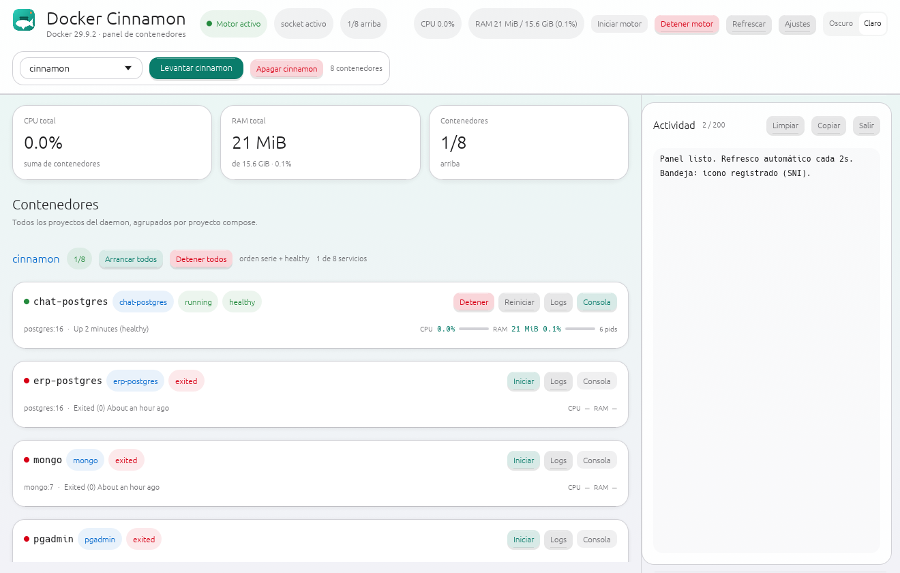
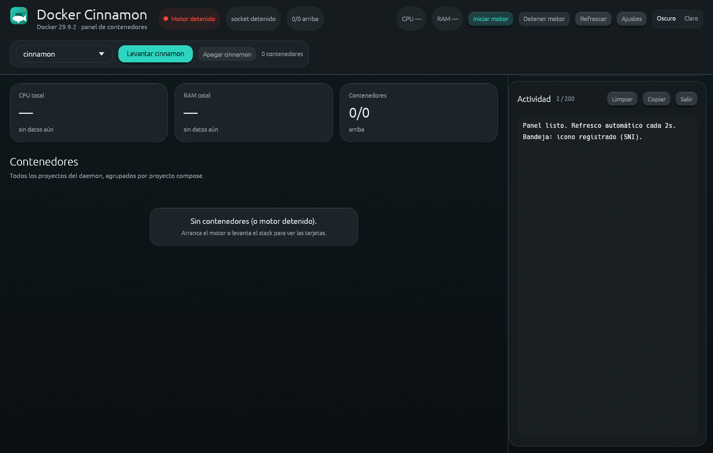

# Docker Cinnamon

<p align="center"></p>

Panel nativo Linux en Rust/egui para el motor Docker, el stack compose de
Cinnamon y **cualquier** contenedor o proyecto del daemon, sin terminal.

[](https://github.com/Canopus44/cinnamon-docker/actions/workflows/ci.yml)
[](LICENSE)

| Tema claro | Tema oscuro |
|---|---|
|  |  |

## Características

- **Motor Docker**: Iniciar/Detener vía
  `pkexec /usr/bin/systemctl start/stop docker.socket docker`. Detener pide
  confirmación porque apaga **todos** los contenedores de **todos** los
  proyectos.
- **Selector de proyecto en el header**: `Levantar <proyecto>` /
  `Apagar <proyecto>` para **cualquier** proyecto compose o contenedores
  sueltos (`Sin proyecto`). Cinnamon conserva el arranque en serie con espera
  `healthy` (timeout 900 s: dos `ng serve` en paralelo agotan la RAM y mueren
  con exit 137); el resto de proyectos usan `docker start` secuencial.
- **Tarjetas por contenedor** con estado y salud, imagen, uptime, CPU/RAM y
  acciones Iniciar/Detener/Reiniciar/Logs.
- **Resumen arriba**: CPU total, RAM total y contenedores; métricas cada 5 s
  (`docker stats --no-stream`).
- **Bandeja SNI**: Abrir panel, Iniciar/Detener motor, Refrescar,
  Levantar/Apagar proyecto seleccionado, Salir. Cerrar la ventana la oculta en
  la bandeja; si no hay bandeja disponible, la ventana cierra con normalidad.
- **Tema claro/oscuro estilo iOS 26** con selector en el header; la
  preferencia queda persistida.
- **Panel de actividad lateral redimensionable** con Copiar, Limpiar y
  auto-scroll.
- **CLI** para scripts: `--status`, `--containers`, `--help`.
- **No borra contenedores ni volúmenes**, sin telemetría, un solo binario.

## Requisitos

- Linux con X11 o Wayland (la app corre por XWayland).
- Docker Engine + plugin Compose v2.
- `polkit`/`pkexec` para el botón de motor.
- Rust stable para compilar.
- Usuario en el grupo `docker` para CLI y métricas.

Dependencias de build:

```bash
# Arch
sudo pacman -S --needed base-devel rust docker docker-compose polkit \
  libxkbcommon libx11 libxi libxcursor libxrandr mesa fontconfig

# Debian / Ubuntu
sudo apt install build-essential pkg-config libxkbcommon-dev libx11-dev \
  libxi-dev libxcursor-dev libxrandr-dev libgl1-mesa-dev libfontconfig1-dev \
  docker.io docker-compose-v2 policykit-1
```

> Nota: si tu distro no trae `docker compose` v2, instala el plugin oficial de
> Docker; la app ejecuta `docker compose`, no `docker-compose`.

## Instalación rápida

```bash
git clone https://github.com/Canopus44/cinnamon-docker.git
cd cinnamon-docker
cargo build --release -j 2
./install.sh
```

`install.sh` copia a `~/.local` el binario, `icon.svg`, `icon-symbolic.svg` y
un `.desktop` con `Exec` absoluto, y refresca los caches de iconos y escritorio
si existen. No necesita root. Respeta `PREFIX`:

```bash
sudo env PREFIX=/usr/local ./install.sh   # instalación en sistema
```

Asegura que `~/.local/bin` esté en el `PATH`:

```bash
export PATH="$HOME/.local/bin:$PATH"
```

Paso a paso, desinstalación y autostart en
[docs/install.md](docs/install.md).

## Paquete y releases

Los releases están en
[github.com/Canopus44/cinnamon-docker/releases](https://github.com/Canopus44/cinnamon-docker/releases).
El paquete portable `cinnamon-docker-<versión>-x86_64-linux.tar.gz` incluye el
binario, los iconos SVG, el `.desktop`, `install.sh`, el README y la licencia.

```bash
tar xzf cinnamon-docker-0.2.0-x86_64-linux.tar.gz
cd cinnamon-docker-0.2.0-x86_64-linux
./install.sh
```

Verifica el checksum desde el directorio que contiene ambos archivos:

```bash
sha256sum -c cinnamon-docker-0.2.0-x86_64-linux.tar.gz.sha256
```

## Uso

**GUI**: ejecuta `cinnamon-docker`, elige el proyecto en el header,
levántalo o apágalo con los botones y usa las acciones de cada tarjeta
(Iniciar/Detener/Reiniciar/Logs).

**Bandeja**: el clic izquierdo sobre el icono abre el panel; el menú ofrece
Abrir panel, Iniciar/Detener motor, Refrescar, Levantar/Apagar proyecto
seleccionado y Salir. «Salir» termina el proceso; cerrar la ventana sólo la
oculta.

**CLI** (sale con 0):

| Comando | Salida |
|---|---|
| `cinnamon-docker` | Ventana. |
| `cinnamon-docker --status` | Motor, socket, versión y tabla de los 8 servicios Cinnamon (estado, salud, detalle). |
| `cinnamon-docker --containers` | Todos los contenedores con proyecto, nombre, estado, salud, imagen y detalle. |
| `cinnamon-docker --help` | Ayuda y ruta efectiva del compose. |

Con el motor apagado la CLI no consulta el daemon (el socket lo
reactivaría): muestra el estado del motor y los servicios como `detenido`.

## Configuración

### Compose de Cinnamon

`CINNAMON_DOCKER_COMPOSE` define la ruta del compose del stack Cinnamon. Si no
se define, se usa la ruta por defecto del autor:

```bash
export CINNAMON_DOCKER_COMPOSE="$HOME/proyectos/Cinnamon/docker-compose.yml"
```

Se lee al arrancar; `cinnamon-docker --help` muestra la ruta efectiva.

### Tema

El selector del header guarda la preferencia en
`~/.config/cinnamon-docker/theme` (`light` o `dark`). `XDG_CONFIG_HOME` se
respeta.

### Constantes

| Constante | Valor | Para qué |
|---|---|---|
| `SERVICES` | los 8 servicios Cinnamon | Orden de arranque en serie y columna del CLI. |
| `REFRESH_EVERY` | 2 s | `docker ps -a` y estado del motor. |
| `STATS_EVERY` | 5 s | `docker stats --no-stream`. |
| `WAIT_TIMEOUT` | 900 s | Espera de `healthy` por servicio. |

El resto de comportamiento se edita en `src/main.rs`: no hay más configuración
en runtime.

## Cómo funciona

La UI corre en el hilo principal con `eframe`/`egui` 0.37 (renderer `glow`);
el refresco, las métricas y las acciones corren en hilos propios comunicados
por `mpsc`; la bandeja usa `ksni`. Detalles, invariantes y puntos de extensión
en [docs/architecture.md](docs/architecture.md). Problemas típicos en
[docs/troubleshooting.md](docs/troubleshooting.md).

## Limitaciones y seguridad

- **No borra nada**: sólo `start`/`stop`/`restart`/`logs`/`ps`/`stats` y
  `compose up -d`. No hay `rm`, `down -v` ni borrado de volúmenes.
- **Detener el motor apaga todos los contenedores** de todos los proyectos;
  por eso hay modal de confirmación.
- **Sin daemon remoto**: sólo el Docker local (`DOCKER_HOST` no se usa).
- **`pkexec`** pide autenticación en cada arranque/parada del motor.
- Requiere sesión gráfica X11 o XWayland; no hay modo headless (usa la CLI).
- La ruta del compose es configurable por variable de entorno, pero el stack
  Cinnamon sigue teniendo sus 8 servicios en `SERVICES`: para otro stack con
  arranque en serie hay que editar `src/main.rs` y recompilar.

## Contribuir

Lee [CONTRIBUTING.md](CONTRIBUTING.md). Checks obligatorios: `cargo fmt
--check`, `cargo clippy --all-targets -- -D warnings`, `cargo test`,
`cargo build --release`.

## Licencia

MIT © 2026 Santiago Molina. Ver [LICENSE](LICENSE).
